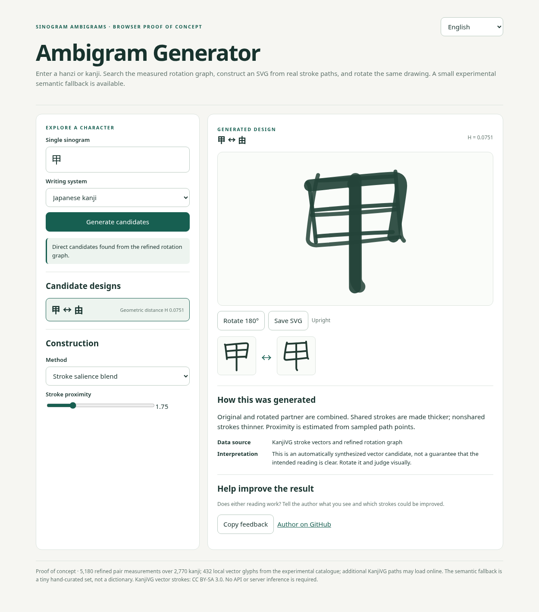
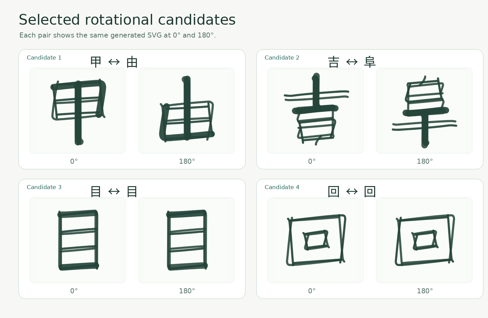

# Sinogram Ambigrams

**A 180° turn can change more than the shape of a character.**

> **Current scope:** Japanese KanjiVG research (2,770 Jōyō + Jinmeiyō kanji) and a **separate, experimental Mainland Chinese GB2312 track** (6,763 characters; Make Me a Hanzi source). The Chinese explorer provides coarse geometric candidates, **not verified legible ambigrams**, and source glyphs are not independently certified by region. See [SCOPE.md](SCOPE.md) and [limitations](#known-limitations--cultural-scope).

**Read in:** English · [简体中文](docs/zh/README.md) · [日本語](docs/ja/README.md)

A research and art project by **Claudio Drews** exploring how Chinese *hanzi* and Japanese *kanji* can be transformed into **rotational ambigrams**: a single drawing designed to suggest one character upright and another after a half-turn. It brings together geometric search, stroke-level construction, structural decomposition and visual interpretation.

Inspired by the ambigram art of [Issei Nomura](https://x.com/IsseiNomura) and by a fascination with the intersection of **geometry, language, perception and meaning**. This is an independent project, not affiliated with or endorsed by the artist.



### Selected rotational candidates



*Four exploratory SVG constructions generated by the browser application: 甲 ↔ 由, 吉 ↔ 阜, 目 ↔ 目 and 回 ↔ 回. Each design is shown upright and after a half-turn; judge the two intended readings visually.*

## Explore the project

**[Visit the live project website](https://claudiodrews.github.io/sinogram-ambigram/)** or open the interactive tools:


| Interactive experience | What you can do |
| --- | --- |
| **[Ambigram Generator](https://claudiodrews.github.io/sinogram-ambigram/generator/)** | Enter a Chinese or Japanese character, inspect ranked rotational neighbors, build a vector candidate, rotate it and save the SVG. Includes a small, explicitly curated semantic-alternative fallback. |
| **[Rotation Lab](https://claudiodrews.github.io/sinogram-ambigram/demo/)** | Explore **16 examples**, including dense and complex characters; compare geometric overlays, shared strokes, salience, symmetry and component-layout demonstrations. |
| **[C₂ Visual Research Lab](https://claudiodrews.github.io/sinogram-ambigram/demo/c2/)** | Interactively decompose the same KanjiVG drawing into C₂-even/odd parts, move the rotation centre, and explore reproducible PRC width-geometry and A/B null-result measurements. Includes distinct conceptual local/harmonic field views, three interface languages, and **no readability claim**. |
| **[Mainland Chinese Explorer](https://claudiodrews.github.io/sinogram-ambigram/prc/)** | Browse the separate PRC-source GB2312 candidate shortlist, compare 180° rotated source overlays and inspect coarse geometric rankings. English, 简体中文 and 日本語. **No human legibility validation.** |

| **[Native Reader Gallery](https://claudiodrews.github.io/sinogram-ambigram/evaluation/recognition/)** | Choose **Chinese (汉字) or Japanese (漢字)**, tap each consolidated experimental ambigram to rotate it 180°, and indicate whether meaning can be read in **both, one, or neither** orientation. See the construction method, optionally add notes, and download CSV or TXT feedback. No account or proficiency questions. The two source tracks are exploratory and are not a validated readability benchmark. |\n\nThe original Generator and Rotation Lab use **Japanese KanjiVG geometry** even when the interface language or input character is Chinese. The new **PRC Explorer** uses separately sourced Chinese geometry and does not mix regional rankings. Source code: [`generator/`](generator/), [`demo/`](demo/), [`prc/`](prc/).

### A first example: 甲 ↔ 由

The generator looks for characters whose stroke geometry becomes similar after **180° rotation**. It uses a KanjiVG-based ranking to select potential partners and combines the original stroke skeleton with the rotated partner. The combined drawing is meant to be judged by rotating it and comparing it with the reference characters. It is an experimental drawing, not a claim that every candidate will be legible.

## How it works

```text
Input character
    │
    ├─ Rotation-graph search: identify geometric neighbors
    ├─ Vector construction: combine original and 180°-rotated strokes
    ├─ Explore methods: salience / overlay / shared skeleton / C₂ symmetry
    └─ If no suitable direct candidate: try a small curated semantic alternative
                 ↓
        Interactive, rotatable SVG + method explanation + feedback
```

**Core formal idea.** For rotation $R(x,y)=(-x,-y)$ in centered coordinates, a drawing $g$ is an A/B ambigram when it is perceived as **A** upright and **B** after applying $R$. The project's geometric scores rank *shapes*, while the visitor's visual assessment helps judge whether a particular drawing succeeds.

The current prototype is intentionally small: the generator indexes **5,180 refined measurements** over **2,770 characters** (including 2,770 self-pairs); it embeds vectors for **432 characters** and may load further KanjiVG paths on demand. Its fallback is a small set of curated semantic alternatives, **not** a comprehensive Chinese/Japanese synonym dictionary. The Rotation Lab offers 16 selected examples. Neither application requires an LLM or server-side runtime.

### PRC median-skeleton ingestion (implemented)

The implemented reproducible PRC stage reads the pinned Make Me a Hanzi stroke medians, checks the source SHA-256, and builds a local 109 × 109 point-cloud/distance-transform cache. See the [ingestion specification](docs/prc-ingest-spec.md) and [`code/stage12_prc_ingest.py`](code/stage12_prc_ingest.py). The intermediate cache is **not itself** a Chinese-wide ranking. The subsequent GB2312 repertoire preset and coarse search are implemented; however, the source forms have not been certified individually as normative Mainland simplified variants. Median distances must not be compared directly with filled-ink construction scores.

### Mainland Chinese: reproducible research stages

The independent [pinned-source reproduction](findings/prc-source-reproduction.md) verified **9,574** Make Me a Hanzi glyph records, **6,763/6,763** GB2312 characters covered, and two byte-identical full median-skeleton cache builds. The 9,534 figure in an earlier internal roadmap is not the count of this pinned source.

The [PRC ingestion stage](code/stage12_prc_ingest.py), [inventory preset builder](code/stage13_prc_presets.py) and [coarse rotation search](code/stage14_prc_search.py) can produce locally auditable candidates. The [coarse search method](methods/PRC_COARSE_SEARCH.md) documents its 37×37 IoU and full-cohort null model. **These are not a complete PRC ambigram generator or a human-validated ranking**: the licensed source geometry and intermediate caches remain local, while the public PRC Explorer distributes a compact numerical shortlist. Precise pair refinement and regional glyph-form certification remain separate research tasks. A small, controlled image-only VLM recognition **pilot has been completed on a draft branch**; it is not a human-reader validation (see the research-status section below). The archived 120/53 construction-cohort measurements have been [independently reproduced from pinned source geometry](methods/PRC_V116_REPRODUCTION.md).

### Experimental Mainland Chinese construction method

The separate **CN-S (Mainland simplified Chinese)** research track now includes a deterministic, synthetic-tested construction module at [`code/prc_construct.py`](code/prc_construct.py), with [`30 targeted tests`](code/test_prc_construct.py). It explores rotation-centre optimisation, terminal stroke reconciliation, and constrained sector-wise thickness changes. See the [mathematical method](theory/prc-construction-method.md) and [PRC geometric analysis](findings/prc-extremity-analysis.md).

**Integrated geometric correction:** [PR #19](https://github.com/ClaudioDrews/sinogram-ambigram/pull/19) merged the measured half-width fix into `code/prc_construct.py` while preserving the exact historical v1.16 implementation in `code/prc_construct_legacy_v116.py` for archived replay. Against 32 pinned source-outline cases, corrected original-outline IoU improved in **32/32** (median **0.4743 → 0.9083**). This is a geometric reconstruction result, **not** evidence of human readability. See the [width-semantics method](methods/PRC_WIDTH_SEMANTICS.md) and [fidelity findings](findings/prc-width-contour-fidelity.md).

**Scope boundary:** this remains an experimental *construction method*, not a Chinese-wide generator or a human-validated legibility result. The archived PRC construction-cohort measurements have a separate pinned-source reproduction documented above; that does **not** validate the still-draft R-ODD, harmonic-field, or A/B fusion experiments or the readability of their outputs. Native-reader studies and certified regional forms remain outstanding. Japanese and PRC-source inventories must not be mixed in rankings.

### Research currently in draft branches (not released on `main`)

The public website and the source on `main` are distinct from proposed changes in open experimental pull requests. **Do not interpret a draft PR as an integrated release.**

| Draft work | Status and evidence |
| --- | --- |
| [PR #13](https://github.com/ClaudioDrews/sinogram-ambigram/pull/13) — original thickness draft | **Not merged directly.** Its geometric fix was integrated safely by PR #19 with historical replay preserved; #13 remains an open draft for provenance. |
| [PR #14](https://github.com/ClaudioDrews/sinogram-ambigram/pull/14) — R-ODD | Local rotated-ink thickness-compensation experiment; not a validated ambigram generator. |
| [PR #15](https://github.com/ClaudioDrews/sinogram-ambigram/pull/15) — harmonic field | C₂-even smooth thickness field; geometric invariance is not evidence of readability. |
| [PR #16](https://github.com/ClaudioDrews/sinogram-ambigram/pull/16) — A/B fusion | Experimental stroke registration and fusion; neither tested distinct-character pair was recognized in the pilot. |
| [PR #17](https://github.com/ClaudioDrews/sinogram-ambigram/pull/17) — [blind VLM pilot](https://github.com/ClaudioDrews/sinogram-ambigram/tree/exp/vlm-reading-benchmark/experiments/vlm-reading-pilot-01) | Sanitized English/Chinese protocol, 52 image stimuli, 208 automated recognition responses, reproducible scoring and source-pinned image reconstruction. **Draft, not merged.** |
| [PR #21](https://github.com/ClaudioDrews/sinogram-ambigram/pull/21) — A/B fusion threshold study | Independent frozen cohort of 32 new A/B pairs, tested at thresholds 2, 4, 8, 12 and 16. At 16, 31/32 pairs registered at least one stroke, but **0/32 final raster images changed**. The no-op persists downstream of matching. [Diagnostic](findings/prc-ab-fusion-null-diagnosis.md) and [draft results](https://github.com/ClaudioDrews/sinogram-ambigram/blob/exp/ab-fusion-threshold-sensitivity/experiments/ab-fusion-threshold-v1/RESULTS.md). **Draft, not merged.** |

In the small, preselected self-rotation pilot, correct recognition of both orientations occurred in **10/20** model-by-glyph observations for the historical geometry, **14/20** for corrected thickness, **13/20** for R-ODD and **15/20** for harmonic construction. The two A/B pairs had **zero correct dual readings** across methods; A/B fusion produced the same images as the corrected simple-union control for those pairs. The separate 32-pair threshold study in draft PR #21 also produced unchanged final rasters across all 32 new pairs, despite registration succeeding for 31/32 at the highest tested threshold. Neither experiment establishes the general viability or impossibility of A/B fusion. These are **exploratory VLM observations**, not a calibrated perceptual success threshold, independent native-reader study or evidence of robust generalization.

## Research and implementation

| Directory | Contents |
| --- | --- |
| [`theory/`](theory/) | Rotational algebra, IDS composition, stroke families, word-level rules, the legibility-set formulation and stroke families. |
| [`methods/`](methods/) | Search algorithms, vector geometry, distance metrics and the Inoue–Takahashi hiragana method. |
| [`findings/`](findings/) | Experimental results, interesting pairs, disagreements and practical limitations. |
| [`data/`](data/) | [Documented CSV datasets](data/README.md), character lists and provenance of grid vs exact metrics. |
| [`code/`](code/) | Python rotation-graph pipeline components and experimental ambigram synthesis. |
| [`generator/`](generator/) | Standalone browser proof of concept, its technical README and attribution. |
| [`demo/`](demo/) | Rotation Lab: 16 interactive examples. |

The geometric experiment searched the **2,770-character Japanese Jōyō + Jinmeiyō inventory** and generated rankings for **3,837,835 unordered pairs including self-pairs**. The repository retains the selected refined results; it does not include the complete 3.84-million-row archive. This Japanese-derived inventory does **not** cover all Chinese hanzi.

### Try the Python modules

Requires **Python 3.12 or newer** for the versions pinned in `code/requirements.txt`.


```bash
python -m pip install -r code/requirements.txt
bash scripts/download_kanjivg.sh  # pinned source + checksum verification
python -m unittest discover -s code -p 'test_*.py' -v
```

The tests include real CLI execution on synthetic SVG glyphs. Paths default to repository-relative directories, with optional `ROTG_*` environment overrides. For the full numerical pipeline and computational requirements, see the [reproduction protocol](methods/rotgraph-method.md). The [dataset guide](data/README.md) distinguishes exact point-cloud distances from grid-screening approximations. After recomputing the grid pipeline, `python code/export_full_grid.py` optionally creates a complete, labelled CSV archive without adding it to the Git repository.

## Run the demonstrations

Open the [live project website](https://claudiodrews.github.io/sinogram-ambigram/), the [Ambigram Generator](https://claudiodrews.github.io/sinogram-ambigram/generator/) or the [Rotation Lab](https://claudiodrews.github.io/sinogram-ambigram/demo/). Both are hosted through GitHub Pages from the `main` branch. You can also download and open either `index.html` locally; the generator's embedded glyphs work offline, while fetching additional vectors requires internet access.

## Contribute and give feedback

Try a character, rotate the output and compare it with both references. If you see a better reading or a promising transformation, **[open an issue](https://github.com/ClaudioDrews/sinogram-ambigram/issues/new)** and include the character pair, screenshot/SVG, chosen method and your observations. You can also email **[Claudio Drews](mailto:21au6i06R3w55891@proton.me)**.

## Citation

Use the repository's [CITATION.cff](CITATION.cff) to cite Claudio Drews and this software/data release. The current version remains an exploratory prototype; no controlled native-reader validation has been published.

## Known limitations & cultural scope

Read this section before drawing any conclusion from the numbers. It is
summarised here and detailed in [`SCOPE.md`](SCOPE.md),
[`findings/limitations.md`](findings/limitations.md) and
[`LICENSE-AUDIT.md`](LICENSE-AUDIT.md).

**Two separate geometric sources, not one culturally neutral alphabet.** The Japanese research inventory contains 2,136 Jōyō plus 634 Jinmeiyō kanji, represented with **Japanese KanjiVG forms**. The independent PRC-source track covers all 6,763 GB2312 codepoints from **Make Me a Hanzi** and generated 106,347 coarse-screened candidate pairs. The original browser Generator still uses Japanese forms even for Chinese-character input; the separate PRC Explorer uses Chinese-source geometry. These sources are **never mixed** in the same ranking. GB2312 coverage certifies a *codepoint repertoire*, **not** normative simplified/traditional glyph shapes: the PRC source contains both forms and has not been independently audited against region-specific standards.

**A geometric match is a candidate, not a demonstrated ambigram.** Japanese ranking files measure geometric relations between stroke centre-lines; the separate PRC shortlist uses coarse 37×37 ink-overlap screening. Neither directly measures whether a person can read the resulting drawing. A [small blind automated VLM recognition pilot](https://github.com/ClaudioDrews/sinogram-ambigram/pull/17) exists on a **draft branch only**, but there is still **no controlled native-reader study, calibrated ε criterion or human-validated general-purpose recognizer**. Every proposed construction remains a candidate.

**The semantic fallback is tiny.** When a character has no shortlisted
geometric partner, the browser generator offers a related character from a
small hand-curated list. It is an example set, not a synonym dictionary, and
the substitution is shown to the user rather than hidden.

**Known metric biases.** The historical Japanese rotation graph has density and hub biases, and its baseline uses a fixed box-centre rotation; these observations do **not** imply that every newer PRC construction operator fixes the rotation centre. Distinct PRC metrics require separate calibration. Details are documented in
[`findings/limitations.md`](findings/limitations.md) and
[`findings/conflicts-and-corrections.md`](findings/conflicts-and-corrections.md).

**Only the half-turn.** 90° rotation, mirroring and figure–ground inversion
are out of scope. A mirror pair is *not* a rotational ambigram.

**Single glyphs, one writing mode.** The unit of analysis is one character.
Word-level composition, vertical writing and mixed-script strings are not
covered.

**On the cultural claims.** The project works with characters of Chinese
origin as *graphic forms*. It makes no claim about what a character means to
anyone, and it does not present its output as culturally authentic. Where a
traditional concept is discussed — *ma*, *shodō*, *wabi-sabi*, *kotodama* — it
is cited and defined in [`docs/GLOSSARY.md`](docs/GLOSSARY.md) as a lens, not
as a claim about the project's own results.

**Inspiration is not endorsement.** The ambigram art of Issei Nomura inspired
this project. The artist did not author, review or endorse this repository,
and no artwork of theirs is redistributed here.

## Credit and licensing

Original project code and prose by Claudio Drews: [MIT](LICENSE). **KanjiVG-derived vector artwork and adapted stroke data** embedded in the browser demos: [CC BY-SA 3.0](NOTICE.md). KanjiVG is © Ulrich Apel and contributors; see [KanjiVG](https://kanjivg.tagaini.net/). Licenses for the code, measurements and adapted artwork are distinguished in [`NOTICE.md`](NOTICE.md). The work of Issei Nomura is an inspiration, not content redistributed by this project.

**Research provenance:** model names in the experiment notes identify tools or experimental runs, not co-authors.