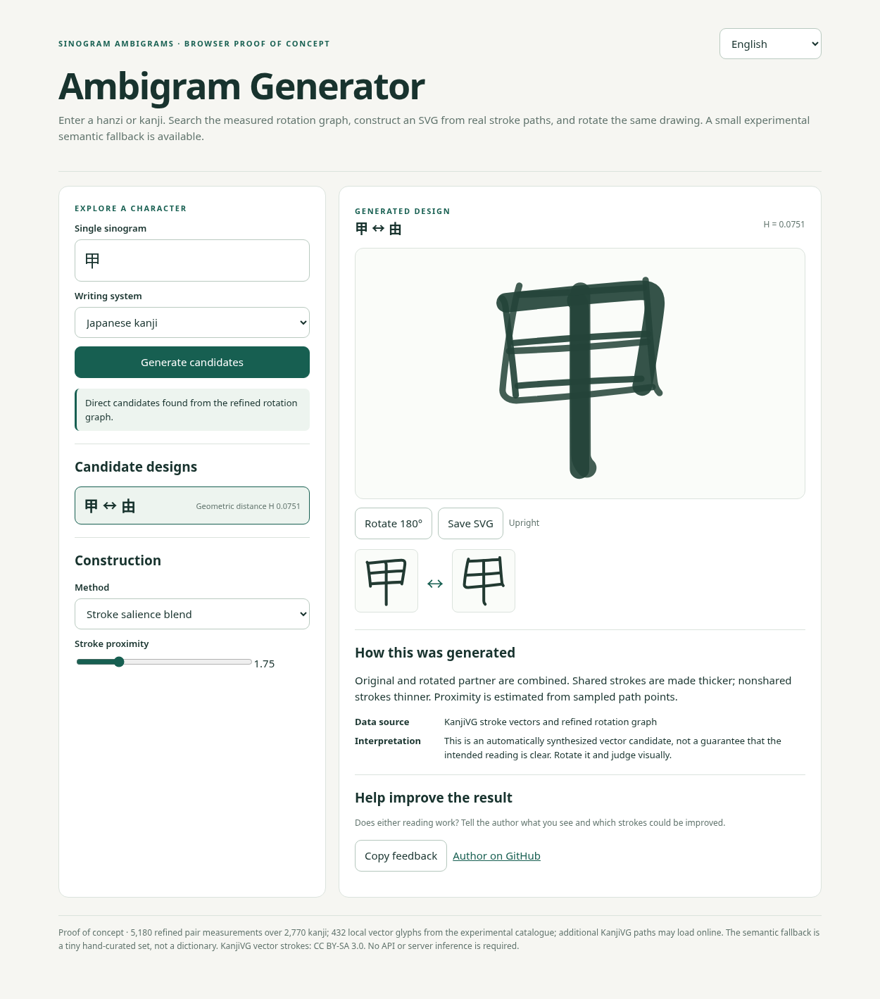
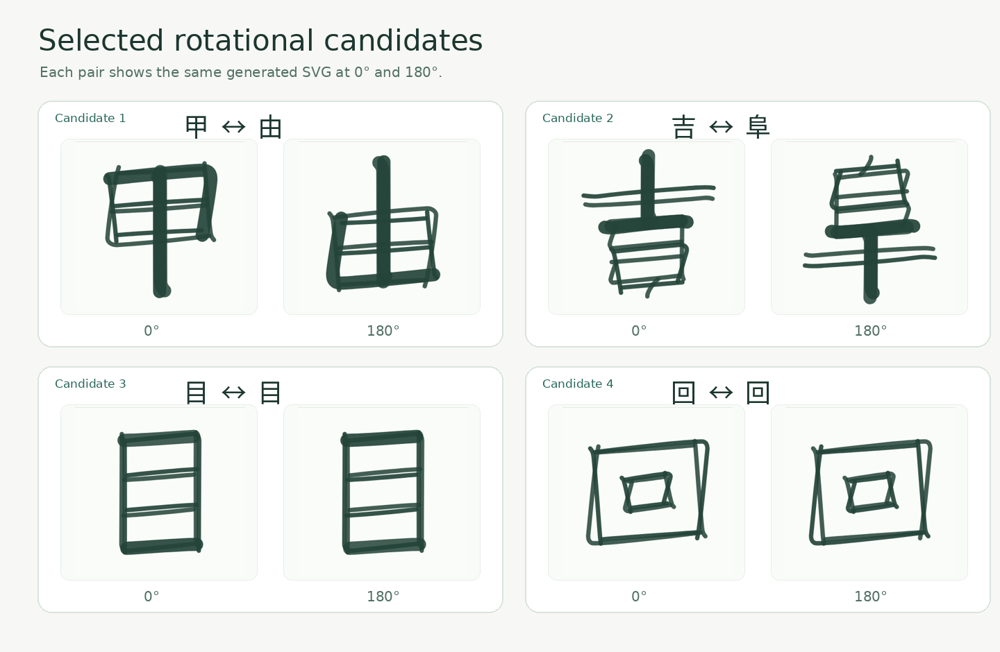

# 漢字回転アンビグラム · Sinogram Ambigrams

**180°回転すると、一つの図形は別の文字や意味に変わるだろうか。**

**言語：** [English](../../README.md) · [简体中文](../zh/README.md) · 日本語

> **現在の範囲：** 日本標準の漢字 2,770 字（KanjiVG）と、**独立した中国大陸 GB2312 の実験系**（6,763 字、Make Me a Hanzi 由来）。中国語系の結果は粗い幾何学的候補であり、**人間による読字検証は未実施**。簡体字・繁体字の字形の個別認証も未完了です。詳細は [SCOPE.md](../../SCOPE.md) と[制限事項](#既知の制限と文化的範囲)を参照。

このプロジェクトは、**幾何学、言語、知覚、意味**の交点を探る研究・アートの試みです。中国語の漢字と日本語の漢字を対象に、正位置と180°回転後で異なる字形として読める図形（回転アンビグラム）を調べています。[Issei Nomura](https://x.com/IsseiNomura) 氏のアンビグラム作品から着想を得ていますが、本人との共同制作・公認プロジェクトではありません。

### 回転字形のギャラリー

*生成器で作成した4組の実験的な候補：甲 ↔ 由、吉 ↔ 阜、目 ↔ 目、回 ↔ 回。回転前後の形と対象文字を見比べてください。*

## まず試す

- **[中国大陸の漢字回転候補エクスプローラー](https://claudiodrews.github.io/sinogram-ambigram/prc/?lang=ja)**：独立した GB2312 の粗い幾何ランキングと原字形の180°重ね合わせを表示。**読字検証なし**、完成したアンビグラム生成器ではありません。

- **[アンビグラム生成器](https://claudiodrews.github.io/sinogram-ambigram/generator/)**：漢字を入力して回転後の形が近い候補を検索し、SVGを合成します。生成方式を変更し、180°回転して比較し、SVGを保存できます。意味の近い別の字を試す機能は**少数の手作業で定義した例**のみで、一般的な同義語辞書ではありません。
- **[Rotation Lab](https://claudiodrews.github.io/sinogram-ambigram/demo/)**：**16例**を使い、複雑な字形、ストロークの重ね合わせ、線の強調、C₂対称性、構成要素の配置を試せます。両方とも英語・中国語・日本語のUIを備えます。

**[プロジェクトサイト](https://claudiodrews.github.io/sinogram-ambigram/)** と上記の二つのデモは GitHub Pages で公開済みです。ソースコードは [`generator/`](../../generator/) と [`demo/`](../../demo/) にあります。

## 仕組み

1. 回転距離の実験データから入力文字の候補を検索。
2. KanjiVGのベクターストロークを読み取り、相手の字を180°回転して重ねます。
3. 強調度による合成、単純な重ね合わせ、共通骨格、C₂対称性を比較。
4. 直接候補がない場合は、小規模な意味関連文字の候補を試します。
5. 回転可能なSVG、使用方法の説明、フィードバック導線を表示します。

現行データは**2,770文字**と**5,180件の精密測定**を含みます。生成器には**432文字**分のベクターデータが含まれ、その他はオンライン取得を試みます。元の対象は常用漢字・人名用漢字を中心としており、**中国語の漢字全体を収録しているわけではありません**。最終的な読みやすさは、図形を実際に回転して比較することが大切です。

## 技術資料

現在固定されている依存ライブラリには **Python 3.12 以降**が必要です。

- [理論](../../theory/)：回転代数、IDS構造、文字の族ごとの規則。
- [手法](../../methods/)：探索アルゴリズム、距離指標と合成手法。
- [研究結果](../../findings/)：候補ペア、観察、手法上の論点。
- [データ](../../data/)：CSVランキングと文字集合。
- [Pythonコード](../../code/)：実験的実装とテスト。
- [生成器の技術説明（英語）](../../generator/README.md)。

## 既知の制限と文化的範囲

この節の数字から結論を導く前に必ず読んでください。以下は要約であり、詳細は [SCOPE.md](../../SCOPE.md)、
[`findings/limitations.md`](../../findings/limitations.md)、
[`LICENSE-AUDIT.md`](../../LICENSE-AUDIT.md) にあります。

**データは日本の漢字である。** 文字集合は常用漢字 2,136 字と人名用漢字 634 字。すべての字形は
KanjiVG の**日本**標準字形であり、**簡体字・繁体字**などの地域別の字形は**測定対象ではない**。
中国語話者に見えているのは、中国の書き方ではなく日本語の字形である。

**幾何の一致は候補であり、アンビグラムではない。** `data/` の数値はストローク中心線間の距離で、
180°回転後にどれだけ重なるかを順位付けする。**読者が読めるかを測ったものではない。** 本プロジェクトでは
読解テスト・ε の較正・ネイティブ話者による研究のいずれも**公表していない**。したがってここにある
結果はすべて**候補**である。

**意味による代替のリストは小さい。** 幾何的な候補がない文字には、手で少数の関連文字を用意し提示する。
これは辞書ではなく例示であり、置き換えは利用者に明示される。

**度量には既知の偏りがある。** 順位は無偏ではない。密な字形は箱を埋めるだけで有利になりやすく、
一部の字形が上位に集中し、回転中心は字面の中央に固定されている。これらは
[`findings/limitations.md`](../../findings/limitations.md) と
[`findings/conflicts-and-corrections.md`](../../findings/conflicts-and-corrections.md) で
記述・数値化されている。

**半回転のみ。** 90°回転、鏡映、図地反転は対象外である。**鏡映の対は回転アンビグラムではない。**

**単位は単一文字、書記体は一種のみ。** 分析の単位は一文字である。語の組み合わせ、縦書き、
混在文字列は扱っていない。

**文化に関する主張について。** 本プロジェクトが扱うのは漢字の**図形**である。ある文字が誰に
どう意味を持つかについて的主張はせず、成果物を文化的に正統なものとして提示することもない。
*ma*（間）、*shodō*（書道）、*wabi-sabi*（侘寂）、*kotodama*（言霊）などの伝統的概念に触れ
るときは、出典と定義を [`docs/GLOSSARY.md`](../../docs/GLOSSARY.md) に示しており、本研究の
結果についての主張ではなく、一つの視点として示している。

**着想は承認ではない。** 本プロジェクトは Issei Nomura 氏のアンビグラム作品から着想を得た。
同氏は本リポジトリの執筆・レビュー・承認には関わっておらず、同氏の作品も再配布していない。

## フィードバックとライセンス

気になる候補や改善案があれば、文字の組・生成方法・SVGや画像を添えて [GitHub Issueを作成](https://github.com/ClaudioDrews/sinogram-ambigram/issues/new) してください。[Claudio Drewsにメール](mailto:21au6i06R3w55891@proton.me)で連絡することもできます。独自コードと文章は [MIT](../../LICENSE)、KanjiVG由来のストロークデータと加工した図形は [CC BY-SA 3.0](../../NOTICE.md) です。詳しくは[出典・ライセンス表記](../../NOTICE.md)をご覧ください。