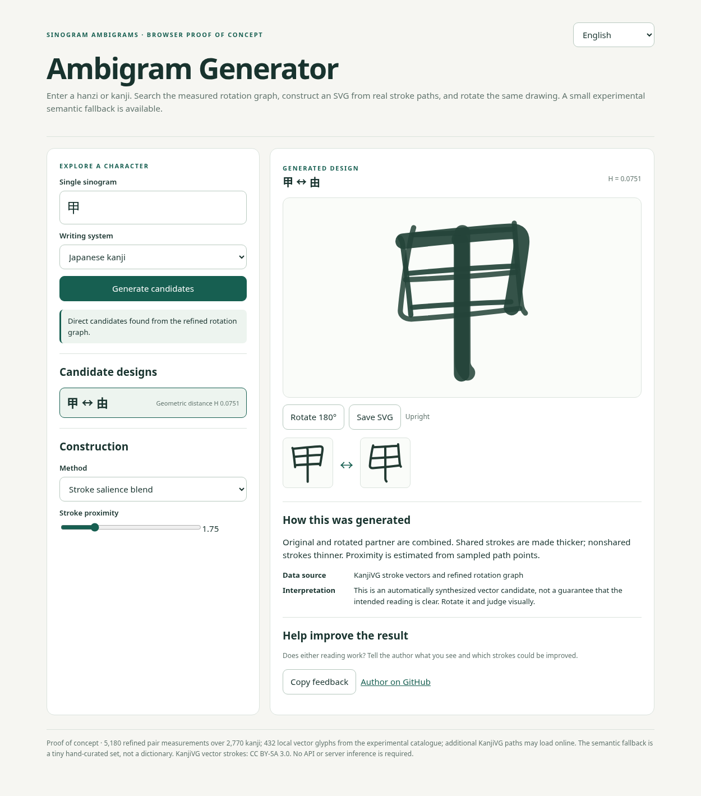
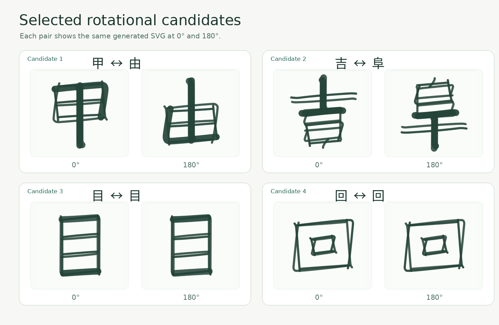

# 汉字旋转双读字形 · Sinogram Ambigrams

**旋转 180°，同一图形能否呈现另一种字形与含义？**

**语言：** [English](../../README.md) · 简体中文 · [日本語](../ja/README.md)

> **当前范围：** 日语 KanjiVG 字形数据集（2,770 字），以及**独立的中国大陆 GB2312 实验轨道**（6,763 字，源自 Make Me a Hanzi）。中文结果只表示初步几何候选，**尚无人类辨识验证**；数据源中的简繁字形尚未逐字完成权威规范核对。详情见 [SCOPE.md](../../SCOPE.md) 与[已知限制](#已知限制与文化范围)。

本项目结合**几何、语言、视觉感知与意义**，探索汉字和日语汉字的旋转双读字形（rotational ambigrams）：同一图形在正向与旋转 180° 后，可能呈现不同的字符。灵感来自 [Issei Nomura](https://x.com/IsseiNomura) 的双读文字艺术。这是一项独立研究与艺术实验，与该艺术家没有合作或背书关系。

### 旋转字形示例

*由生成器生成的四组实验性字形：甲 ↔ 由、吉 ↔ 阜、目 ↔ 目、回 ↔ 回。请将两个方向与目标字符进行视觉比较。*

## 立即体验

- **[中国大陆汉字旋转候选探索](https://claudiodrews.github.io/sinogram-ambigram/prc/?lang=zh)**：独立的 GB2312 旋转候选排名，提供原始字形叠加和 180° 旋转预览。使用中文来源几何，**没有经过人类可读性验证**；目前不是自动生成可辨识双读字的成品。

- **[双读字形生成器](https://claudiodrews.github.io/sinogram-ambigram/generator/)**：输入一个汉字，搜索旋转后几何形状相近的候选字，合成可旋转的 SVG、切换构造方法并下载。仅提供**少量人工整理的语义替代字**，不是完整的同义词词典。
- **[Rotation Lab](https://claudiodrews.github.io/sinogram-ambigram/demo/)**：探索 **16 个示例**，包括复杂结构、笔画重合、显著性调节、中心对称和构件布局。两种演示均支持英语、中文和日语界面。

**[项目网站](https://claudiodrews.github.io/sinogram-ambigram/)** 和上方两个交互工具已通过 GitHub Pages 发布。也可以从 [`generator/`](../../generator/) 和 [`demo/`](../../demo/) 查看源代码。

## 基本方法

1. 从已有的旋转距离数据中为输入字符寻找候选配对。
2. 读取 KanjiVG 的笔画矢量路径，将候选字旋转 180° 后叠加。
3. 尝试笔画显著性融合、直接叠加、共用骨架或 C₂ 对称方法。
4. 若没有适合的直接候选，可尝试小型语义替代列表。
5. 展示可旋转 SVG、采用的方法与反馈方式。

目前的研究数据包括 **2,770 个字符**与 **5,180 条精细测量记录**。生成器内置 **432 个字符**的笔画矢量，其他字符可尝试联网加载。原始字符集合主要来自日语常用汉字和人名用汉字，**并未涵盖所有中文汉字**。生成的图形需要通过实际旋转和目视比较来判断效果。

## 简体中文字形轨道

独立的 PRC 来源数据流程已在 `main` 的研究代码中实现，并有 [PRC 探索器](../../prc/) 展示 GB2312 的粗略候选排名。来源为 Make Me a Hanzi，数据与日本 KanjiVG 不混合。经过来源哈希校验的 9,574 条原始记录涵盖全部 6,763 个 GB2312 字符；但这些数值只是几何筛选结果，不代表字形规范认证或人类可读性。

## 实验分支状态（尚未合并至 main）

当前公开网站与 `main` 中已经发布的功能，应和仍处于草稿阶段的实验性 PR 区分开来：

- [PR #13](https://github.com/ClaudioDrews/sinogram-ambigram/pull/13)：PRC 笔画半宽重建修正。
- [PR #14](https://github.com/ClaudioDrews/sinogram-ambigram/pull/14)：R-ODD 局部旋转墨迹补偿。
- [PR #15](https://github.com/ClaudioDrews/sinogram-ambigram/pull/15)：C₂ 对称的平滑谐波笔画厚度场。
- [PR #16](https://github.com/ClaudioDrews/sinogram-ambigram/pull/16)：针对两个不同字符的笔画匹配和融合实验。
- [PR #17](https://github.com/ClaudioDrews/sinogram-ambigram/pull/17)：[视觉语言模型盲测](https://github.com/ClaudioDrews/sinogram-ambigram/tree/exp/vlm-reading-benchmark/experiments/vlm-reading-pilot-01)，52 张图像、四种模型、208 次模型识读结果及可重复运行的评分程序（英语和简体中文文档）。

在五个预先选定的自旋转字符中，各方法的双方向识读正确数分别为：历史基线 **10/20**、厚度修正 **14/20**、R-ODD **13/20**、谐波场 **15/20**。两个异字配对的双方向识读均未成功。该小样本试验只能作为**自动化识读的探索性证据**，不能替代人类母语读者实验，也不能据此认定某算法具有普遍有效性。

## 代码与研究资料

当前 Python 依赖需要 **Python 3.12 或更新版本**。

- [理论](../../theory/)：180° 旋转、IDS 结构代数及字形规则。
- [方法](../../methods/)：候选搜索、距离度量与生成思路。
- [研究结果](../../findings/)：候选字对、实验结果和方法比较。
- [数据](../../data/)：CSV 排名、字符列表和来源信息。
- [Python 代码](../../code/)：实验性处理与测试。
- [生成器说明（英文）](../../generator/README.md)：运行与技术细节。

## 已知限制与文化范围

在根据这些数字得出结论之前，请先阅读本节。摘要如下，详见 [SCOPE.md](../../SCOPE.md)、
[`findings/limitations.md`](../../findings/limitations.md) 与
[`LICENSE-AUDIT.md`](../../LICENSE-AUDIT.md)。

**现有两套独立的字形数据，而非只有日语字形。** 日本研究轨道使用 KanjiVG 的 2,136 个常用汉字及 634 个人名用汉字；中国来源轨道使用 Make Me a Hanzi 数据，覆盖全部 6,763 个 GB2312 码位，并产生 106,347 个粗筛候选配对。两套数据及其排名**不相互混合**。原始浏览器生成器即使输入中文字符仍使用日语 KanjiVG 字形；独立的 PRC 探索器使用中国来源字形。**GB2312 的码位覆盖不等于简体中文规范字形认证**：来源同时含有简体与繁体字形，尚未完成逐字的地区规范核验。

**几何匹配只是候选，并非已证实可读的双读字形。** 日语研究轨道的排名使用笔画中线距离，中国来源轨道的粗筛采用 37×37 网格旋转后墨迹重叠度；这些指标均不直接测量人类阅读。项目已在[实验性 PR #17](https://github.com/ClaudioDrews/sinogram-ambigram/pull/17) 中发布小规模的视觉语言模型盲测方法及结果，**但尚未合并至 `main`**。仍未完成 ε 阈值标定、母语读者受控研究或人类可读性验证。

**语义回退集合很小。** 当某字没有几何候选时，浏览器生成器会从一份手工整理的小列表中给出
语义相关的字。这是示例集合，不是同义词词典，而且替换过程对用户可见。

**已知的度量偏差。** 历史日语旋转图存在密度偏差、枢纽字符偏差，其基线采用固定字框中心旋转；这些限制不应直接套用到全部新的 PRC 构造算子。不同数据源和度量需要分别验证。这些偏差在
[`findings/limitations.md`](../../findings/limitations.md) 与
[`findings/conflicts-and-corrections.md`](../../findings/conflicts-and-corrections.md)
中有记录与量化。

**只处理 180° 旋转。** 90° 旋转、镜像与图底反转不在范围内。**镜像字对不是**旋转双读字形。

**以单字为单位，只覆盖一种书写方式。** 分析单位是一个字符。词组组合、竖排书写与混排文本
均未涵盖。

**关于文化表述。** 本项目处理的是汉字的**图形形式**。它不对某个字符对任何人意味着什么作出
主张，也不将自身产出呈现为文化上地道的内容。当涉及传统概念时——*ma*（間）、*shodō*（書道）、
*wabi-sabi*（侘寂）、*kotodama*（言霊）——均在 [`docs/GLOSSARY.md`](../../docs/GLOSSARY.md)
中给出出处与定义，作为一种视角，而非对本项目结果的断言。

**灵感不等于背书。** 本项目受 Issei Nomura 的双读文字艺术启发。该艺术家未参与撰写、审阅或
背书本仓库，仓库也未再分发其任何作品。

## 参与与致谢

欢迎[提交 GitHub Issue](https://github.com/ClaudioDrews/sinogram-ambigram/issues/new)，附上字符配对、方法、SVG 或截图与改进建议；也可通过[电子邮件](mailto:21au6i06R3w55891@proton.me)联系作者 Claudio Drews。原创代码和文字遵循 [MIT](../../LICENSE)；源自 KanjiVG 的笔画矢量及其改编内容遵循 [CC BY-SA 3.0](../../NOTICE.md)。详见[版权与来源说明](../../NOTICE.md)。